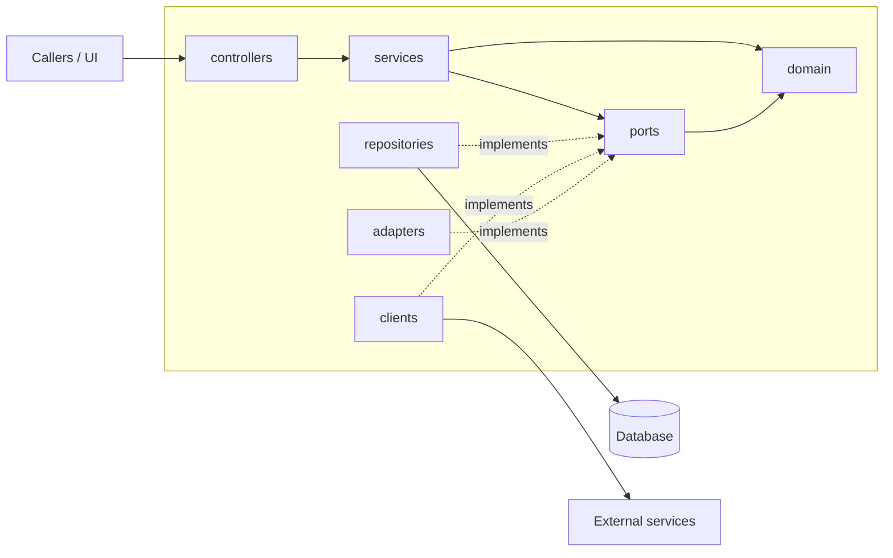

# <app> architecture

> Fleet standard: standards/ARCHITECTURE-RULES.md. This file describes how <app> applies it. Keep it short and current; update it in the same commit as any structural change.

## Purpose
One paragraph: what <app> does, who calls it, and what it owns (data, ports, external systems).

## Diagram

Edit the diagram to show this app's real parts: its actual services, databases, queues and the other fleet apps it calls (by port number from standards/ports.json).

## Layers and role map
Dependencies point inwards: domain <- ports <- services <- controllers. Implementations (repositories, clients, adapters) depend on ports and domain only. Framework and IO imports live only at the edges and in the composition root.

| role | folder(s) in this repo |
|---|---|
| domain | |
| ports | |
| services | |
| controllers | |
| DTOs / mappers | |
| repositories / clients / adapters | |
| composition root | |

Source of truth: `fleet-layers.json`. Boundaries are enforced in `make ci` (dependency-cruiser for Node, ArchUnit for Java).

## Rules that apply here
- No cycles. Modules are imported only through their `index.ts`.
- Files <= 200 lines; fan-out <= 10 imports.
- Per-role complexity and size limits come from `.fleet/arch/eslint.arch.mjs` (edge functions <= 3 cyclomatic, services/domain <= 10).
- Note any rule this app deviates from, and why.

## Runtime
Port, health (`/health`, `/ready`), config and secrets (names only), how to run it (`make` targets), and which other fleet apps it talks to.

## Decisions
Short dated entries replacing separate ADR files. One bullet per significant decision: what was decided, why, and what was rejected.
- YYYY-MM-DD: decision. Why. Alternatives rejected.
