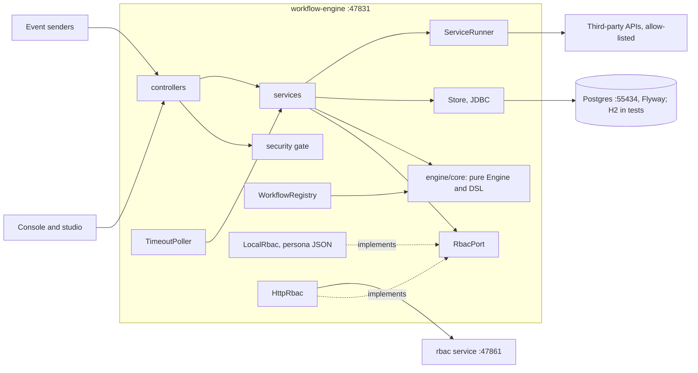

# workflow-engine architecture

> Fleet standard: standards/ARCHITECTURE-RULES.md. This file describes how workflow-engine applies it. Keep it short and current; update it in the same commit as any structural change.

## Purpose
workflow-engine runs long-lived business workflows (approvals, rework loops, signature events, timeouts) defined in a Kotlin DSL. Callers are the browser console (served at `/`), the React studio in `apps/web` (mocked against its own contract), and other systems that send events (`POST /events/{name}`). It owns the workflow definitions (code), instance state, user tasks, event waits and an append-only event log, all in its own Postgres. It calls external systems only through service tasks (linked handlers and a built-in allow-listed `http` task) and, when configured, the central rbac service.

## Diagram

Fleet apps called: only `rbac` (:47861), and only in live mode (`RBAC_URL`); dev uses `LocalRbac`. No other fleet app is required.

## Layers and role map
Dependencies point inwards: domain <- ports <- services <- controllers. Implementations (repositories, clients, adapters) depend on ports and domain only. Framework and IO imports live only at the edges and in the composition root.

| role | folder(s) in this repo |
|---|---|
| domain | `engine/core` (`dev.workflow.core`: DSL, validation, graph, Mermaid export, pure `Engine`); sample workflow definitions in `app/workflow` |
| ports | `app/rbac/RbacPort.kt` only. There is no `ports` package yet (see Deviations) |
| services | `app/runtime` (`InstanceService`, `ServiceRunner`, `TimeoutPoller`, `DemoGate`); `app/rbac` policy (`AppModel`) |
| controllers | `app/api` (`Controllers.kt`, `DemoController.kt`, `DiagramPage.kt`); `app/security` interceptors and annotations |
| DTOs / mappers | `app/api/Dtos.kt` (no separate mappers) |
| repositories / clients / adapters | repositories: `app/persistence` (`Store`); adapters: `app/registry`, `app/diagrams`, `app/samples`, `app/rbac` (`LocalRbac`, `HttpRbac`) |
| composition root | `WorkflowEngineApplication.kt`, `app/rbac/RbacConfiguration.kt`, `app/security/WebConfig.kt` |

Source of truth: `fleet-layers.json`. Boundaries are checked by ArchUnit (`engine/app/src/test/kotlin/dev/workflow/app/architecture/ArchitectureTest.kt`) in report-only mode via `./gradlew :engine:app:archReport`; they are not yet enforced in `make ci`.

## Rules that apply here
- No cycles between top-level packages; `engine/core` stays pure Kotlin (no Spring, no I/O) per CLAUDE.md.
- Files <= 200 lines; fan-out <= 10 imports.
- Per-role complexity and size limits (detekt for the JVM) are not adopted yet.
- Deviations, stated plainly:
  - Services depend on the concrete `Store` and `WorkflowRegistry`, not ports (only `RbacPort` is a port). The report-only ArchUnit run lists these violations.
  - `Controllers.kt` (292), `Store.kt` (250) and `InstanceService.kt` (263) exceed 200 lines.
  - `app/security` is not in `fleet-layers.json`; it is treated as part of the controller edge.
  - Service tasks run inside the instance row lock in one transaction (v1 choice): a slow handler blocks that instance.
  - Workflow DSL objects in `app/workflow` are declarative data and are mapped to their own `workflow` role.

## Runtime
- Port 47831; liveness at `/health` (no `/ready` yet). OpenAPI at `/openapi.json`, docs at `/docs`.
- Config (names only): `PORT`, `RBAC_URL`, `AUTH_MODE` (`dev` default or `live`), `SUPABASE_JWT_SECRET`, `SUPABASE_JWKS_URL`, `workflow.demo.enabled`. Live mode refuses to start without `RBAC_URL` and the JWT secret. Dev trusts `X-User`; live verifies an HS256 Bearer JWT and ignores `X-User`.
- Access is deny by default: `IdentityInterceptor` (401) then `PermissionInterceptor` (403); every route declares `@Requires`, `@Authenticated` or `@Public`.
- Run: `make dev` (stops any old copy, starts Postgres on :55434, runs the engine, opens the console); `make test` / `make ci` (Gradle `check` plus the web gate); `make share` serves the studio demo build through ngrok.
- Tests: in-memory H2 for the default suite; Postgres-tagged tests run in `postgresTest` with Testcontainers.
- Depends on no other fleet app to start.

## Decisions
- 2026-11-04: `Engine` is a pure transition function in `engine/core`; the app applies its effects. Keeps the engine testable without I/O. Rejected: an engine that persists itself.
- 2026-11-04: every step yields an enum outcome and routing is an exhaustive `when`. The compiler checks every path. Rejected: free-form string routing and `else` branches.
- 2026-11-04: events are append-only, enforced by a Postgres trigger. The history stays trustworthy.
- 2026-11-05: service tasks run inside the instance lock. Simple and consistent. Rejected for v1: async handlers with callbacks.
- 2026-11-05: the studio in `apps/web` is built against its own contract, not the engine's endpoints, behind one `ApiPort`. A real backend needs one new adapter.
- 2026-11-06: backend e2e runs on H2 in PostgreSQL mode; real-Postgres tests are tagged and run in the full gate only. Fast pre-commit.
- 2026-11-06: RBAC behind `RbacPort` with `LocalRbac` (dev) and `HttpRbac` (central rbac service); deny by default via a central interceptor. Rejected: per-handler checks (a read was left unenforced and fixed).
- 2026-11-06: the engine console is the demo surface and the studio is the mocked test UI. Rejected: a separate preview API (E8 dropped).
