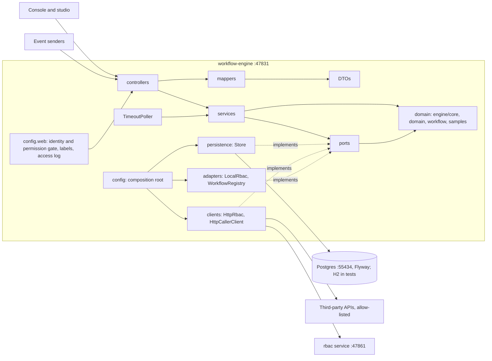

# workflow-engine architecture

> Fleet standard: standards/ARCHITECTURE-RULES.md. This file describes how workflow-engine applies it. Keep it short and current; update it in the same commit as any structural change.

## Purpose
workflow-engine runs long-lived business workflows (approvals, rework loops, signature events, timeouts) defined in a Kotlin DSL. Callers are the browser console (served at `/`), the React studio in `apps/web` (mocked against its own contract), and other systems that send events (`POST /events/{name}`). It owns the workflow definitions (code), instance state, user tasks, event waits and an append-only event log, all in its own Postgres. It calls external systems only through service tasks (linked handlers and a built-in allow-listed `http` task) and, when configured, the central rbac service.

## Diagram

Fleet apps called: only `rbac` (:47861), and only in live mode (`RBAC_URL`); dev uses `LocalRbac`. No other fleet app is required.

## Layers and role map
Dependencies point inwards: domain <- ports <- services <- controllers. Implementations (repositories, clients, adapters) depend on ports and domain only. Framework and IO imports live only at the edges and in the composition root.

| role | package(s) under `dev.workflow` |
|---|---|
| domain | `core` (DSL, validation, graph, Mermaid export, pure `Engine`), `app.domain` (rows, errors, rbac models, `AppModel`), `app.workflow` (the sample workflow DSL objects), `app.samples` (linked handlers), `app.telemetry` (pure telemetry primitives: `Job`, `EndpointContext`, `UseCaseSpans`) |
| ports | `app.ports`: `WorkflowStore` (`InstanceOps`, `TaskOps`, `WaitOps`), `WorkflowDefinitions`, `WorkflowCatalog`, `RbacPort`, `HttpCaller` |
| services | `app.runtime` (`InstanceService`, `TaskService`, `Transitions`, `ServiceRunner`, `TimeoutPoller`, `DefinitionService`, `RunQueries`, `AccessService`, `DemoGate`), `app.security` (`Authorizer`, `TaskAuthorizer`, `Identity`, annotations, permissions) |
| controllers | `app.api` (one controller per area, `ErrorHandler`, `DemoProviders`) |
| DTOs / mappers | DTOs: `app.api.dtos`. Mappers: `app.mappers` (`InstanceMapper`, `TaskMapper`, `ExportMapper`, `DiagramPage`, ...) |
| repositories / clients / adapters | repositories: `app.persistence` (`Store` over `InstanceRepository`, `TaskRepository`, `WaitRepository`); clients: `app.clients` (`HttpRbac`, `HttpCallerClient`, `OriginPropagation`); adapters: `app.adapters` (`LocalRbac`, `WorkflowRegistry`, `Workflows`) |
| composition root | `WorkflowEngineApplication.kt` and `app.config` (bean wiring, logging and OTel set-up, `app.config.web` filters and interceptors) |

Source of truth: `fleet-layers.json`. Boundaries are enforced by ArchUnit (`engine/app/src/test/kotlin/dev/workflow/app/architecture/ArchitectureTest.kt`, an ordinary test, so `./gradlew check` runs it): layering, services depend only on ports, no web/JDBC/HTTP frameworks in pure roles, no cycles, every class placed in a role. The fleet presets are copied unmodified into `.fleet/arch/`.

## Rules that apply here
- `engine/core` stays pure Kotlin (no Spring, no I/O) per CLAUDE.md.
- Size and complexity (arch.2): detekt `dev.detekt` 2.0.0-alpha.6, two tasks wired into `check`. `detektEdge` (limits 3 / 6 lines / depth 1 / 3 params) covers `api`, `persistence`, `clients`, `mappers`, `adapters`. `detektCore` (10 / 20 lines / depth 3 / 4 params, cognitive 15) covers `runtime`, `security`, `domain`, `telemetry`, `samples`, `workflow`, `config/web` and `engine/core`. DTOs are excluded. Configs: `config/detekt/edge.yml`, `core.yml`. No limit was raised and no suppression added.
- Duplication (arch.9): jscpd 4.0.5 (`.jscpd.json`, format kotlin, under 3%), the `duplication` Gradle task in `check`. Currently 0.72%.
- Files are at most 200 lines.
- Deviations, stated plainly:
  - `app.config.web` (the identity and permission interceptors, access-log filter, deprecated-alias filter) is composition wiring, checked with the core limits rather than the edge limits.
  - A controller calls a service and then `RunQueries` to build the response view, so some handlers make two service calls.
  - `telemetry` is a cross-cutting package mapped to domain: it has no web, database or HTTP framework imports.
  - Service tasks run inside the instance row lock in one transaction (v1 choice): a slow handler blocks that instance.

## Runtime
- Port 47831; liveness at `/health` (no `/ready` yet). OpenAPI at `/openapi.json`, docs at `/docs`.
- Config (names only): `PORT`, `RBAC_URL`, `AUTH_MODE` (`dev` default or `live`), `SUPABASE_JWT_SECRET`, `SUPABASE_JWKS_URL`, `workflow.demo.enabled`. Live mode refuses to start without `RBAC_URL` and the JWT secret. Dev trusts `X-User`; live verifies an HS256 Bearer JWT and ignores `X-User`.
- Access is deny by default: `IdentityInterceptor` (401) then `PermissionInterceptor` (403); every route declares `@Requires`, `@Authenticated` or `@Public`.
- Run: `make dev` (stops any old copy, starts Postgres on :55434, runs the engine, opens the console); `make test` / `make ci` (Gradle `check` plus the web gate); `make share` serves the studio demo build through ngrok.
- Tests: in-memory H2 for the default suite; Postgres-tagged tests run in `postgresTest` with Testcontainers.
- Depends on no other fleet app to start.

## Decisions
- 2026-11-04: `Engine` is a pure transition function in `engine/core`; the app applies its effects. Keeps the engine testable without I/O. Rejected: an engine that persists itself.
- 2026-11-04: every step yields an enum outcome and routing is an exhaustive `when`. The compiler checks every path. Rejected: free-form string routing and `else` branches.
- 2026-11-04: events are append-only, enforced by a Postgres trigger. The history stays trustworthy.
- 2026-11-05: service tasks run inside the instance lock. Simple and consistent. Rejected for v1: async handlers with callbacks.
- 2026-11-05: the studio in `apps/web` is built against its own contract, not the engine's endpoints, behind one `ApiPort`. A real backend needs one new adapter.
- 2026-11-06: backend e2e runs on H2 in PostgreSQL mode; real-Postgres tests are tagged and run in the full gate only. Fast pre-commit.
- 2026-11-06: RBAC behind `RbacPort` with `LocalRbac` (dev) and `HttpRbac` (central rbac service); deny by default via a central interceptor. Rejected: per-handler checks (a read was left unenforced and fixed).
- 2026-11-07: the architecture rules are enforced in `check`: ArchUnit, detekt (two tasks) and jscpd. Controllers reach data only through services; services reach it through ports (`WorkflowStore`, `WorkflowDefinitions`, `RbacPort`, `HttpCaller`) with the implementations in `persistence`, `clients` and `adapters`. Rejected: raising limits or adding suppressions.
- 2026-11-06: the engine console is the demo surface and the studio is the mocked test UI. Rejected: a separate preview API (E8 dropped).
