# workflow-engine

A deliberately small workflow engine with a Kotlin DSL. It covers approvals, waiting for external events and calling third-party APIs. Every workflow draws itself as a diagram, and the Kotlin compiler refuses any workflow that leaves an outcome unrouted.

## One concept

Every step produces an **outcome** (an enum), and `on { when (it) { … } }` routes it.

| Step | Does | Outcomes |
|---|---|---|
| `userTask` | Waits for an eligible user, assigned by `role(...)`, `user(...)` or `userFrom("vars.path")` | Your enum, e.g. `APPROVE, REJECT, COUNTER`; or `Done` |
| `serviceTask` | Runs linked Kotlin code (`handler<H>()`) or a built-in `http { }` call | Whatever the handler returns; or `Done` |
| `eventWait` | Parks until `POST /events/{name}` arrives with a matching correlation | `RECEIVED`, plus `TIMED_OUT` with `timeout(...)` |
| `decision` | Pure branch on vars | Your enum |

Routes:
- `next()`: the default, so most steps need no routing.
- `goto("step")`
- `end("status")`
- `path("name") { steps }`: rejoins after the branching step when it runs off its end.

Technical failures, such as a handler that keeps throwing, are not outcomes. They become an **incident**, which you clear with `POST /instances/{id}/retry`.

### The compiler enforces routing
- A `when` missing an outcome does not compile.
- A multi-outcome step without `on { }` does not compile; its block must end with it.
- A handler whose outcome type differs from the task's does not compile.

Things Kotlin can't see are checked at startup and in `./gradlew check`: unknown `goto` targets, duplicate ids, unreachable steps, and a `TIMED_OUT` route without a timeout.

## Getting started

### 1. Prerequisites
- **Java 25.** Gradle's toolchain uses it; `java -version` should say 25.
- **Docker** (Docker Desktop running). It runs Postgres for the engine and for the tests.
- Nothing else: Gradle comes with the repo (`./gradlew`), and the console needs no build.

### 2. Start it (always fresh)
```sh
cd ~/Projects/workflow-engine
make dev
```
`make dev` always starts from a clean state:
1. **Stops any running copy of the engine** on port 47831. It only stops the workflow engine. If another app holds the port, it stops and tells you the PID, and leaves that app alone.
2. Starts Postgres in Docker on `127.0.0.1:55434` if it isn't already running.
3. Runs the engine on **port 47831**. Database tables are created automatically on first start.

Once the engine is up, `make dev` opens the console (http://localhost:47831/) in your browser. Set `NO_BROWSER=1 make dev` to skip that.

You can also check it's ready with:
```sh
curl localhost:47831/health      # {"status":"ok"}
```
To stop the engine without restarting it: `make stop`.

If the port is used by something that isn't the engine, change the port for this run: `PORT=<port> make dev`. The two samples that call the fake third parties (counterparty-onboarding and clause-change-approval) hard-code `localhost:47831` in their DSL, so change those URLs to match.

### 3. Stop it, or start clean
- `Ctrl-C` stops the engine in the terminal, or `make stop` from another one.
- `make down` stops Postgres and **deletes all instances**. The next `make dev` starts from empty.

### 4. Run the tests
```sh
make test       # same as ./gradlew check; Docker must be running
```
This runs:
- **unit tests** for the DSL, validation, graph and engine;
- **compile-fail tests**, which prove the compiler rejects unrouted outcomes;
- **end-to-end tests** over HTTP against a throwaway Postgres, one per feature of each sample workflow;
- **a check that `docs/workflows` matches the DSL.** If it fails, run `make diagrams`.

## Using the console

Open **http://localhost:47831/** in a browser. You need an internet connection the first time: the diagram library (Mermaid) loads from a CDN.

### The one idea: who you are acting as
The **Acting as** box in the sidebar is who you are. Every click is sent to the engine as that user (the `X-User` header). Nothing else identifies you: there are no logins in dev. Type a name or pick one. On a task, the **Act as** buttons switch you to someone allowed to do it in one click.

The dev users come from `engine/app/src/main/resources/application.yaml` (`workflow.rbac.grants`, with display names under `workflow.rbac.people`). Pick a name in the sidebar and their teams appear as chips above it:

| Login (`X-User`) | Name | Role | Used in |
|---|---|---|---|
| `a.ops` | Alex Turner | (requester, no role needed) | starts things, reworks drafts, revises clause changes |
| `l.jones` | Laura Jones | `legal` | confirmation-approval, clause-change-approval |
| `d.head` | David Okafor | `desk-head` | large-trade sign-off |
| `c.acme` | Carla Mendes | `counterparty-signatory`, only for ACME | counterparty negotiation |
| `k.comply` | Kieran Walsh | `compliance`, only for region EU | onboarding due diligence, regulatory clause changes |
| `m.lro` | Marcus Reid | `mlro` | onboarding escalations |
| `o.ops` | Olivia Park | `onboarding-ops`, only for region EU | account set-up |
| `m.office` | Maya Osei | `middle-office` | trade repair and unmatched confirmations |
| `p.maint` | Priya Nair | (named directly in the DSL) | clause release scheduling |
| `p.owner` | Pablo Ortiz | (named in the change's data) | product owner sign-off |
| `ops.admin` | Sam Patel | `ops` | reassigns any open task (see below) |
| `i.handler` | Ivan Hale | `incident-handler` | retries a failed step once the cause is fixed |
| `h.legal` | Harriet Lane | `head-of-legal`, plus every legal team | head of legal, in all four legal teams |
| `l.rossi` | Lucia Rossi | `legal-italy` | Italian legal |
| `l.dubois` | Louis Dubois | `legal-france` | French legal |
| `l.weber` | Lena Weber | `legal-germany` | German legal |
| `w.support` | Riley Chen | `workflow-support` | restarts any workflow at any user task (see below) |

Pick someone who isn't allowed and the engine refuses with the reason, for example *'a.ops' does not hold role 'legal'*. That's worth trying.

### The four pages
| Page | What it's for |
|---|---|
| **Definitions** | Every workflow. Open one to see its diagram, a table of its steps (kind, who it's assigned to, where each outcome goes) and **Start instance** with sample data you can edit. **Open picture** shows the diagram on its own with SVG and PNG downloads. |
| **Instances** | Every run, newest first, with a status filter and counts. Open one to drive it (see below). |
| **My tasks** | The inbox for whoever you're acting as, plus every open task. Click a row to open its instance. |
| **Demos** | **Start with sample data** for each workflow, switches for the fake third parties (take the booking system down or up), and the users table. Click a user to act as them. |

### Who holds a task: user or team
Every user task is either **team-scoped** (any member of a role can take it, for example *legal*) or **user-scoped** (one named person holds it, for example the requester who must amend a draft). This shows in three places:
- **Diagram:** 👥 with a *team · legal* line for team tasks, 👤 with a *user · …* line for user tasks.
- **Console:** a badge on each task (**👥 Team task** or **👤 User task**) and a *Held by* column on **My tasks**.
- **API:** `scopedTo` (`user` or `team`) on every task.

### Restarting a workflow at a step
Support staff with the **`workflow-support`** role (`w.support`, Riley Chen) can move any workflow back to any user task. Open on the instance page, the **Restart at a step** panel lists the user tasks, and **Restart here** moves the workflow there. Open tasks and waits are cancelled, the cancelled rows stay in the history, and vars are kept. The restart is recorded as `restarted`, with the step it came from. A finished workflow can be reopened the same way. Anyone without the role is refused with the reason.

The API: `POST /instances/{id}/restart` with `{"step": "amend-draft"}`. It only accepts user tasks.

### Reassigning a task
Any open user task has a **Reassign this task** panel under its buttons. It moves the task to a named user or to a team, and it's a separate permission from completing the task. By default only the **`ops`** role may reassign (`ops.admin` in the dev grants). Anyone else who tries is refused with the reason. Each reassignment is recorded in the timeline as `task-reassigned`, with who held it before and after.

Reassigning moves the open task and nothing else: the workflow's position, vars and history are unchanged. A finished task can't be reassigned.

The API: `POST /tasks/{id}/reassign` with `{"to": "j.smith"}` for a user, or `{"to": "legal", "toTeam": true}` for a team.

### Driving an instance
The instance page is where you test a workflow:
- **Where it is:** the diagram, with finished steps outlined in green and the current step (or the end it reached) in thick orange.
- **Waiting on:** what the workflow needs next.
  - **A user task:** the **Act as** buttons for the people allowed to do it, its form fields, and one button per outcome (APPROVE, REJECT and so on).
  - **An event wait:** the correlation it's waiting for, a payload box pre-filled for the samples, **Send event** (you play the external system), and **Fire timeout now** if it has a timeout.
- **Incident:** a red banner with the error, and **Retry step** once you've fixed the cause.
- **Timeline:** who did what, when, with which outcome. **Vars:** everything the workflow knows, including each step's output.

Press **Refresh** to see changes made elsewhere, for example by the timeout poller.

## Walkthroughs

Each walkthrough starts from **Demos → Start with sample data** for that workflow. You land on the instance page; follow the steps there.

### A. confirmation-approval: approvals, rework, negotiation, signature
1. The instance waits on **Legal review**. Click **Act as `l.jones`**, type a comment, press **REJECT**.
2. **Notify requester** (a service task) runs straight away. Now **Amend draft** waits for `a.ops`, the requester named in the data. Act as `a.ops` and press **RESUBMIT**. It loops back to legal.
3. As `l.jones`, press **APPROVE**. The sample notional is 75m, so **Size check** sends it to **Desk head sign-off**. Act as `d.head`, press **OK**.
4. **Send for signature** runs, then it waits for the **signed** event. Press **Send signed event**. It stamps the copy and ends **completed**.
5. Try again with **COUNTER** at step 1: `c.acme` can negotiate because the counterparty is ACME. Change `counterparty` to anything else in **Definitions → Start instance** and `c.acme` is refused.

### A2. Reassign a task
1. Start **confirmation-approval**. The **Legal review** task is team-scoped (👥 *team · legal*).
2. Open its **Reassign this task** panel while acting as `a.ops`. Try to move it: the engine refuses, because reassigning needs `ops`.
3. Act as `ops.admin`, choose *a user*, type `j.smith`, press **Reassign**. The task is now user-scoped (👤).
4. Act as `j.smith` and approve. Act as `l.jones` and the task is gone from their inbox.
5. Open the timeline: a `task-reassigned` row shows who moved it, from which holder to which.

### B. counterparty-onboarding: third-party call, async reply, risk routing
1. **Request screening** calls the fake provider through the built-in `http { }` task; its reply (a case id) is in Vars. The instance waits for **screening-result**.
2. In the payload box, leave `"risk": "MEDIUM"` and press **Send screening-result event**. The risk route sends it into enhanced due diligence. (Use `LOW` to skip straight to account set-up, or `HIGH` to auto-decline.)
3. **Compliance review** (act as `k.comply`): fill **findings** and tick **pep**, then press **ESCALATE**. Leaving a required field empty gets a refusal.
4. **MLRO decision** (act as `m.lro`): add a rationale, press **ACCEPT**. It drops out of both nested paths into **Set up account**.
5. Act as `o.ops`, enter an **accountId**, press **OK**. The instance ends **completed**.

### C. trade-booking: business outcomes, incidents, timeouts
1. The trade books and waits for **confirmation-matched**, with a 1-minute timeout. Either press **Send confirmation-matched event** (ends **completed**), or **Fire timeout now** (or wait a minute and press Refresh).
2. After the timeout it chases the counterparty and asks middle office. As `m.office`, press **WAIT_AGAIN** to wait again (the diagram loops back), **FORCE_MATCH** to settle, or **CANCEL**.
3. **Incident and retry:** on **Demos**, press **Take booking system down**, then start trade-booking again. The booking fails three times and the instance shows an **Incident**. Bring the system back up, open the instance and press **Retry step**.
4. **Business outcomes:** in **Definitions → trade-booking → Start instance**, set `"ref": "DUP-1"` (ends **duplicate**) or `"quantity": 0` (goes to **Repair trade**). For the repair, act as `m.office`, enter a positive quantity and press **RESUBMIT**: it books again.

### D. clause-change-approval: approval chains and jumping ahead
1. The sample touches 14 templates, so it's **MATERIAL**: **Legal approval** (act as `l.jones`, **APPROVE**), then **Product owner sign-off** (`p.owner`, **OK**), in order.
2. **Schedule release** (act as `p.maint`): enter a release window, press **OK**. **Publish** calls the fake clause store and the instance ends **published**.
3. Start another and press **REQUEST_CHANGES** at legal: it jumps forward to **Revise change** for the author `a.ops`. **RESUBMIT_CHANGE** re-classifies it; **ABANDON_CHANGE** ends it.
4. Edit the vars to `"affectedTemplates": 2` for the **MINOR** route (straight to release), or `"regulatory": true` for compliance then legal.

## Using it without the console

Everything the console does is a plain REST call, listed in Swagger at **http://localhost:47831/docs**. For example:
```sh
curl -s -XPOST localhost:47831/definitions/confirmation-approval/instances -H 'X-User: a.ops' \
  -H 'Content-Type: application/json' -d '{"vars":{"doc":{"id":"D-1","requester":"a.ops","counterparty":"ACME","notional":75000000}}}'
curl -s 'localhost:47831/tasks?mine=true' -H 'X-User: l.jones'
curl -s -XPOST localhost:47831/tasks/<taskId>/complete -H 'X-User: l.jones' -H 'Content-Type: application/json' \
  -d '{"outcome":"REJECT","form":{"comment":"fix clause 4"}}'
```
`curl localhost:47831/definitions/<name>/export` gives the Mermaid source; a browser gets the drawn picture.

## Writing a workflow

The DSLs live in `engine/app/src/main/kotlin/dev/workflow/app/workflow/`, one file per workflow. The Kotlin code their service tasks run lives in `app/samples`.
1. Add a file with an `object MyFlow : Workflow("my-flow", version = 1, { … })`.
2. List it in `Workflows.kt`.
3. Run `make diagrams`, then restart `make dev`.

If an outcome is unrouted, the build fails before anything runs. The confirmation sample, as generated by `make diagrams`:

```mermaid
---
config:
  flowchart:
    curve: linear
    nodeSpacing: 36
    rankSpacing: 56
    padding: 14
    htmlLabels: false
---
%% confirmation-approval v1: generated from the Kotlin DSL; do not edit
flowchart LR
  n_start((" "))
  n_legal_review("#nbsp;#nbsp;#nbsp;#nbsp;#nbsp;#nbsp;#nbsp;#nbsp;#nbsp;#nbsp;#nbsp;#nbsp;#nbsp;#nbsp;👤#nbsp;#nbsp;#nbsp;#nbsp;#nbsp;#nbsp;#nbsp;#nbsp;#nbsp;#nbsp;#nbsp;#nbsp;#nbsp;#nbsp;<br/>Legal review<br/>#nbsp;")
  n_size_check{"✕<br/>Size check"}
  n_send_for_signature("#nbsp;#nbsp;#nbsp;#nbsp;#nbsp;#nbsp;#nbsp;#nbsp;#nbsp;#nbsp;#nbsp;#nbsp;#nbsp;#nbsp;⚙#nbsp;#nbsp;#nbsp;#nbsp;#nbsp;#nbsp;#nbsp;#nbsp;#nbsp;#nbsp;#nbsp;#nbsp;#nbsp;#nbsp;<br/>Send for<br/>signature")
  n_signed("#nbsp;#nbsp;#nbsp;#nbsp;#nbsp;#nbsp;#nbsp;#nbsp;#nbsp;#nbsp;#nbsp;#nbsp;#nbsp;#nbsp;✉#nbsp;#nbsp;#nbsp;#nbsp;#nbsp;#nbsp;#nbsp;#nbsp;#nbsp;#nbsp;#nbsp;#nbsp;#nbsp;#nbsp;<br/>Await<br/>signature")
  n_stamp("#nbsp;#nbsp;#nbsp;#nbsp;#nbsp;#nbsp;#nbsp;#nbsp;#nbsp;#nbsp;#nbsp;#nbsp;#nbsp;#nbsp;⚙#nbsp;#nbsp;#nbsp;#nbsp;#nbsp;#nbsp;#nbsp;#nbsp;#nbsp;#nbsp;#nbsp;#nbsp;#nbsp;#nbsp;<br/>Stamp executed<br/>copy")
  n_end_withdrawn(("withdrawn"))
  n_end_abandoned(("abandoned"))
  n_end_signature_failed(("signature<br/>failed"))
  n_end_expired(("expired"))
  n_end_completed(("completed"))
  subgraph p_rework ["rework"]
    direction LR
    n_notify_requester("#nbsp;#nbsp;#nbsp;#nbsp;#nbsp;#nbsp;#nbsp;#nbsp;#nbsp;#nbsp;#nbsp;#nbsp;#nbsp;#nbsp;⚙#nbsp;#nbsp;#nbsp;#nbsp;#nbsp;#nbsp;#nbsp;#nbsp;#nbsp;#nbsp;#nbsp;#nbsp;#nbsp;#nbsp;<br/>Notify<br/>requester")
    n_amend_draft("#nbsp;#nbsp;#nbsp;#nbsp;#nbsp;#nbsp;#nbsp;#nbsp;#nbsp;#nbsp;#nbsp;#nbsp;#nbsp;#nbsp;👤#nbsp;#nbsp;#nbsp;#nbsp;#nbsp;#nbsp;#nbsp;#nbsp;#nbsp;#nbsp;#nbsp;#nbsp;#nbsp;#nbsp;<br/>Amend draft<br/>#nbsp;")
  end
  subgraph p_negotiation ["negotiation"]
    direction LR
    n_negotiate("#nbsp;#nbsp;#nbsp;#nbsp;#nbsp;#nbsp;#nbsp;#nbsp;#nbsp;#nbsp;#nbsp;#nbsp;#nbsp;#nbsp;👤#nbsp;#nbsp;#nbsp;#nbsp;#nbsp;#nbsp;#nbsp;#nbsp;#nbsp;#nbsp;#nbsp;#nbsp;#nbsp;#nbsp;<br/>Counterparty<br/>negotiation")
  end
  subgraph p_senior ["senior"]
    direction LR
    n_desk_head_sign_off("#nbsp;#nbsp;#nbsp;#nbsp;#nbsp;#nbsp;#nbsp;#nbsp;#nbsp;#nbsp;#nbsp;#nbsp;#nbsp;#nbsp;👤#nbsp;#nbsp;#nbsp;#nbsp;#nbsp;#nbsp;#nbsp;#nbsp;#nbsp;#nbsp;#nbsp;#nbsp;#nbsp;#nbsp;<br/>Desk head<br/>sign-off")
  end
  n_start --> n_legal_review
  n_legal_review -->|"APPROVE"| n_size_check
  n_legal_review -->|"REJECT"| n_notify_requester
  n_legal_review -->|"COUNTER"| n_negotiate
  n_notify_requester --> n_amend_draft
  n_amend_draft -->|"RESUBMIT"| n_legal_review
  n_amend_draft -->|"WITHDRAW"| n_end_withdrawn
  n_negotiate -->|"AGREED"| n_legal_review
  n_negotiate -->|"WALK_AWAY"| n_end_abandoned
  n_size_check -->|"LARGE: notional #gt; 50m"| n_desk_head_sign_off
  n_size_check -->|"NORMAL"| n_send_for_signature
  n_desk_head_sign_off --> n_send_for_signature
  n_send_for_signature -->|"SENT"| n_signed
  n_send_for_signature -->|"REJECTED_BY_PROVIDER"| n_end_signature_failed
  n_signed -->|"RECEIVED"| n_stamp
  n_signed -->|"TIMED_OUT"| n_end_expired
  n_stamp --> n_end_completed
  classDef userTask fill:#fbe7ee,stroke:#b9768f,stroke-width:1.5px,color:#2b1a21
  classDef serviceTask fill:#ffffff,stroke:#5f6b66,stroke-width:1.5px,color:#1c2320
  classDef eventWait fill:#ffffff,stroke:#5f6b66,stroke-width:1.5px,color:#1c2320
  classDef gateway fill:#fff8e6,stroke:#a8842f,stroke-width:1.5px,color:#3a2e10,font-size:12px
  classDef startEvent fill:#ffffff,stroke:#4a7d5c,stroke-width:1.5px,color:#4a7d5c
  classDef endEvent fill:#ffffff,stroke:#2b2b2b,stroke-width:4px,color:#2b2b2b,font-size:11px
  class n_start startEvent
  class n_legal_review,n_amend_draft,n_negotiate,n_desk_head_sign_off userTask
  class n_notify_requester,n_send_for_signature,n_stamp serviceTask
  class n_size_check gateway
  class n_signed eventWait
  class n_end_withdrawn,n_end_abandoned,n_end_signature_failed,n_end_expired,n_end_completed endEvent
  style p_rework fill:none,stroke:#9aa29e,stroke-width:1px,stroke-dasharray:6 4,color:#5f6b66
  style p_negotiation fill:none,stroke:#9aa29e,stroke-width:1px,stroke-dasharray:6 4,color:#5f6b66
  style p_senior fill:none,stroke:#9aa29e,stroke-width:1px,stroke-dasharray:6 4,color:#5f6b66
```



## API

| Endpoint | |
|---|---|
| `GET /definitions`, `/definitions/{n}`, `/definitions/{n}/graph`, `/definitions/{n}/export?format=html\|mermaid\|graph` | definitions and diagrams (a browser gets the drawn picture) |
| `POST /definitions/{n}/instances {vars}` | start |
| `GET /instances`, `/instances/{id}`, `/instances/{id}/events`; `POST /instances/{id}/retry` | instances, history, incidents |
| `GET /tasks?mine=true` (`X-User`); `POST /tasks/{id}/complete {outcome, form}` | inbox and decisions (403 includes the RBAC reason) |
| `POST /events/{name} {correlation, payload}` | receive endpoint for event waits |
| `POST /timeouts/{instance}/{step}` | timeout callback; an in-process poller also fires these |
| `GET /rbac/grants`, `GET`/`POST /demo/...` | dev users, and the fake third parties the samples call |

## Workflow studio (apps/web)

A React studio for the engine, written against its own contract (`apps/web/contract/openapi.yaml`, under `/api/v1`), so it runs without the engine: `make web` (mock data, :5183), `make web-demo` (adds the Demo player with seven chapters), `make web-demo-build` (static `apps/web/dist/` for the fleet stack, served on 15183), `make share` (demo build through ngrok, `NGROK_AUTHTOKEN` from env). `make ci` runs the Gradle checks and the web gate. The views are in [UI-SPEC.md](UI-SPEC.md), the plan and the contract gaps against the engine's current API in [docs/ui-plan.md](docs/ui-plan.md). The static console at `/` is unchanged.

## Layout

- `engine/core`: the DSL, validation, `WorkflowGraph`, `MermaidExporter` and the pure `Engine`. No I/O, no Spring.
- `engine/app`: Spring Boot, with Postgres persistence (append-only `events`), the REST API, the service runner, the RBAC stub and the samples.
- `docs/workflows`: generated `.mmd` and `.graph.json` files. A test fails if they are stale.
